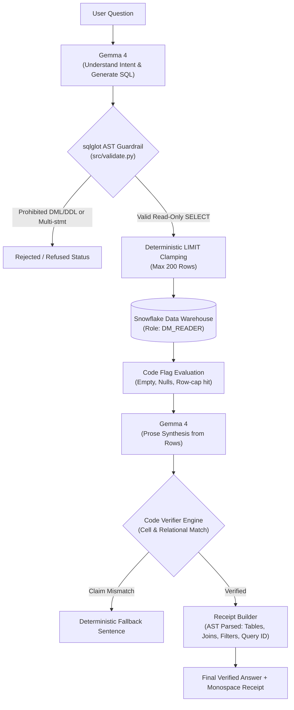

# Problem Statement: PS1 — DataMind: Talk to Your Data

> **Hacktoberfest Hack Day Dharwad × Vidkarya | ZeroDay OSS, IIIT Dharwad**  
> Team: **Code Blooded** | Submission Deadline: Oct 18, 2026, 8:59 PM IST

---

## Architecture Overview

**DataMind Receipts** is designed as a grounded, verifiable natural-language interface to enterprise data in Snowflake. 

Users submit queries in plain English. The system uses **Gemma 4** strictly for language tasks (intent parsing, SQL generation, and row explanation), while **deterministic code** handles AST validation, security guardrails, data fetching, cell-level verification, and receipt construction.



---

## Core System Design

- **Language vs. Determinism Boundary**: Gemma 4 is restricted to semantic understanding and prose generation. All validation, computation, limits, and claim matching are enforced by deterministic Python code.
- **Database Privilege Isolation (Target Architecture)**: Designed to execute queries exclusively under Snowflake's `DM_READER` role (SELECT-only on schema tables). DML/DDL mutations (`INSERT`, `UPDATE`, `DELETE`, `DROP`, `ALTER`, `MERGE`, etc.) are blocked by both AST guardrails and database role permissions.
- **Verifiable SQL Receipts**: Designed to pair every response with an AST-parsed receipt detailing tables touched, joins applied, filters, and Snowflake Query ID.
- **Dynamic Configuration**: Model identifiers, temperatures, and query thresholds are loaded dynamically from `config.yaml` — never hard-coded in Python.

---

## Team Roles & Ownership

| Team Member | Role | Responsibilities |
| :--- | :--- | :--- |
| **Aryan Verma** (Team Lead) | **Person A** | Snowflake warehouse setup, data ingestion, `sql/setup_snowflake.sql`, SQL execution engine |
| **Kolukuri Ashrith** | **Person B** | Backend API, Gemma 4 provider integration, pipeline orchestration, API contract owner |
| **Kataru Deekshith Reddy** | **Person C** | Evaluation harness (`eval/`), test suites (`tests/`), React frontend (`web/`), documentation |

---

## Project Structure

Tracked repository structure:

```text
Code-Blooded/
├── .agent/
│   └── AGENTS.md            # Authoritative developer rules & security constraints
├── datasets/
│   ├── owid.yaml             # Our World in Data schema & indicator declarations
│   └── tpch.yaml             # TPC-H 8-table schema declarations & foreign keys
├── eval/
│   ├── questions.csv         # 30-question ground-truth evaluation harness (draft status)
│   └── run_eval.py           # Independent HTTP-based evaluation runner
├── sql/
│   └── setup_snowflake.sql   # Snowflake RBAC setup (DM_READER, DM_LOADER, DATAMIND schema)
├── src/
│   ├── __init__.py
│   └── validate.py           # AST-based SQL guardrail engine (sqlglot)
├── tests/
│   ├── test_guardrails.py    # DDL/DML rejection & injection test suite
│   ├── test_validate.py      # sqlglot parsing & LIMIT clamping test suite
│   └── test_verify.py        # Cell verification & claim checking test suite
├── web/                      # React + Vite + Tailwind workbench frontend
├── config.yaml               # Runtime configuration (models, limits, temperatures)
├── requirements.txt          # Pinned Python dependencies
├── .env.example              # Clean environment template (no secrets committed)
├── .gitignore                # Excludes secrets, caches, and mock evaluation files
└── LICENSE                   # MIT License
```

---

## Setup & Reproduction

### Current Implementation Status
- **Implemented & Present in Repository**:
  - AST-based SQL safety validator (`src/validate.py`)
  - Full test suites (`tests/test_guardrails.py`, `tests/test_validate.py`, `tests/test_verify.py`)
  - Ground-truth evaluation harness schema (`eval/questions.csv`)
  - Evaluation runner with mock isolation and DM_READER connector (`eval/run_eval.py`)
  - React workbench UI scaffold (`web/`)
- **Pending Integration (Person A & Person B)**:
  - FastAPI server endpoints (`api/`)
  - LLM pipeline integration (`pipeline.py`)
  - Secondary OWID indicator ingestion (`scripts/load_data.py`)
  - Consolidated single-entrypoint runner (`run.py`)

### Prerequisites
1. **Google AI Studio API Key**: Configured in `.env` for Gemma 4 query interpretation.
2. **Snowflake Account**: Trial or standard account with a provisioned `COMPUTE_WH` warehouse.
3. **Environment**: Python 3.11+, Node.js (for frontend build).

### 1. Clone the Repository
```bash
git clone https://github.com/ZERODAY-2026/Code-Blooded.git
cd Code-Blooded
```

### 2. Configure Environment
Copy `.env.example` to `.env`:

**Windows PowerShell:**
```powershell
Copy-Item .env.example .env
```
**Linux / macOS / Bash:**
```bash
cp .env.example .env
```

Fill in your connection details in `.env`:
```ini
GOOGLE_API_KEY=your_gemini_api_key
SNOWFLAKE_ACCOUNT=your_account_identifier
SNOWFLAKE_USER=your_user
SNOWFLAKE_PASSWORD=your_password
SNOWFLAKE_WAREHOUSE=COMPUTE_WH
SNOWFLAKE_DATABASE=DATAMIND
SNOWFLAKE_SCHEMA=OWID
SNOWFLAKE_ROLE=DM_READER
```

### 3. Install Python Dependencies
```bash
pip install -r requirements.txt
```

### 4. Snowflake RBAC Initialization (Person A)
Run `sql/setup_snowflake.sql` in a Snowflake Worksheet as `ACCOUNTADMIN` to create the `DATAMIND` database, `OWID` schema, and `COMPUTE_WH` warehouse grants.

### 5. Run the Test Suites
Execute the test suites using `pytest`:
```bash
python -m pytest tests/ -v
```

### 6. Run the Frontend Workbench
```bash
cd web
npm install
npm run dev
```
Open `http://localhost:3000` (port configured in `web/vite.config.js`) in your browser.  
*(Note: `python run.py` single-command entrypoint is scheduled once FastAPI serves prebuilt `web/dist`).*

---

## Datasets

| Dataset | Schema / Table | Source & Attribution | Description |
| :--- | :--- | :--- | :--- |
| **Our World in Data (OWID)** | `DATAMIND.OWID.life_expectancy` | Our World in Data (CC BY 4.0) — [TODO: upstream source URL] | Global life expectancy indicators across countries and years. |
| **TPC-H Benchmark (SF1)** | `SNOWFLAKE_SAMPLE_DATA.TPCH_SF1.*` | Referenced live from Snowflake Shared Sample Data (not redistributed) | 8 standard relational tables (`CUSTOMER`, `ORDERS`, `LINEITEM`, `NATION`, `REGION`, `SUPPLIER`, `PART`, `PARTSUPP`). |

---

## Red-Team Guardrail Matrix

All SQL generated by the language model is validated by `src/validate.py` before execution. The AST engine enforces the following checks:

| Policy Case | Attempted SQL Syntax | Guardrail Action | Corresponding Test Function |
| :--- | :--- | :---: | :--- |
| **DROP TABLE** | `DROP TABLE CUSTOMER;` | ❌ BLOCKED | `test_drop_table_rejected` |
| **DELETE** | `DELETE FROM CUSTOMER WHERE C_CUSTKEY = 1;` | ❌ BLOCKED | `test_delete_rejected` |
| **INSERT** | `INSERT INTO CUSTOMER (C_NAME) VALUES ('x');` | ❌ BLOCKED | `test_insert_rejected` |
| **UPDATE** | `UPDATE CUSTOMER SET C_ACCTBAL = 0;` | ❌ BLOCKED | `test_update_rejected` |
| **TRUNCATE** | `TRUNCATE TABLE CUSTOMER;` | ❌ BLOCKED | `test_truncate_rejected` |
| **ALTER TABLE** | `ALTER TABLE CUSTOMER ADD COLUMN x VARCHAR;` | ❌ BLOCKED | `test_alter_table_rejected` |
| **MERGE** | `MERGE INTO CUSTOMER USING ...;` | ❌ BLOCKED | `test_merge_rejected` |
| **COPY INTO** | `COPY INTO CUSTOMER FROM @my_stage;` | ❌ BLOCKED | `test_copy_into_rejected` |
| **CALL Procedure** | `CALL my_stored_procedure();` | ❌ BLOCKED | `test_call_rejected` |
| **GRANT / REVOKE** | `GRANT ALL PRIVILEGES ON TABLE CUSTOMER...;` | ❌ BLOCKED | `test_grant_rejected`, `test_revoke_rejected` |
| **CREATE TABLE** | `CREATE TABLE evil_copy AS SELECT ...;` | ❌ BLOCKED | `test_create_table_rejected` |
| **Multi-Statement**| `SELECT * FROM CUSTOMER; DROP TABLE ORDERS;` | ❌ BLOCKED | `test_select_then_drop_rejected` |
| **Unlisted Table** | `SELECT * FROM INFORMATION_SCHEMA.TABLES;` | ❌ BLOCKED | `test_unlisted_table_rejected` |
| **Missing LIMIT** | `SELECT * FROM ORDERS;` | ⚠️ CLAMPED | Enforces `LIMIT 200` |
| **Excessive LIMIT**| `SELECT * FROM ORDERS LIMIT 50000;` | ⚠️ CLAMPED | Clamped to `LIMIT 200` |
| **Valid SELECT** | `SELECT C_NAME, C_ACCTBAL FROM CUSTOMER LIMIT 10;` | ✅ PASSED | `test_simple_select_passes` |

---

## Evaluation Harness (`eval/`)

1. **`eval/questions.csv`**: A 30-question ground-truth evaluation benchmark covering:
   - `single_table` (8 questions)
   - `join` (8 questions, including multi-table joins)
   - `cte_multistep` (5 questions)
   - `ambiguous` (3 questions: 2 answered with stated assumptions, 1 true `clarify`)
   - `empty_or_unsupported` (3 questions: testing `empty` rowsets and out-of-domain `refused`)
   - `followup` (3 multi-turn contextual questions)
   - **Held-out subset**: 10 questions tagged held-out for evaluation.

2. **`eval/run_eval.py`**: Independent runner that queries the API over HTTP, maintains its own separate Snowflake connection as `DM_READER`, and compares result sets using column-name matching, date/number normalisation, and tolerance thresholds.

### Running Evaluation
```bash
# Offline simulation mode (writes strictly to git-ignored eval/results.mock.json)
python eval/run_eval.py --mock

# Live evaluation mode (against running FastAPI service)
python eval/run_eval.py --api-url http://localhost:8000
```

> **Evaluation Notice**: Results are produced by `eval/run_eval.py`. All 30 ground-truth questions currently hold `status=draft`. Rows count toward headline accuracy only once their ground-truth data snapshots have been verified against live data by the team.

---

## Troubleshooting

- **Snowflake MFA / Key-Pair Authentication**: If your Snowflake user enforces Duo MFA or SSO, password authentication will time out. Configure key-pair authentication or set `authenticator='externalbrowser'` in your local configuration.
- **Model Configuration**: Model names and parameters are read directly from `config.yaml`. To switch models or providers, update `config.yaml` rather than editing source code.
- **`[TODO]` Technical Specifications**:
  - *LLM Tier*: `[TODO: Gemma model runtime specifications, exact parameter tier, and benchmark latency to be confirmed post-pipeline integration]`
  - *Data Attribution*: `[TODO: Add exact Our World in Data download timestamp, commit SHA, and upstream indicator URL]`

---

## License

This project is licensed under the **MIT License** — see the [LICENSE](LICENSE) file for details.
