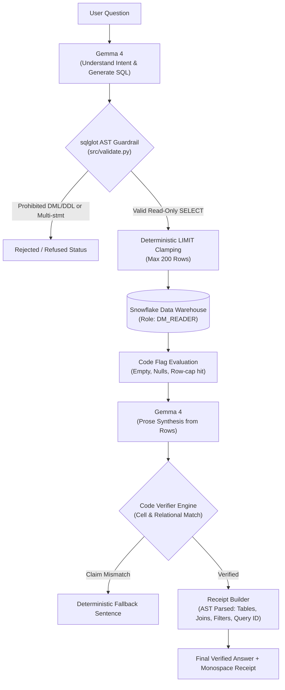
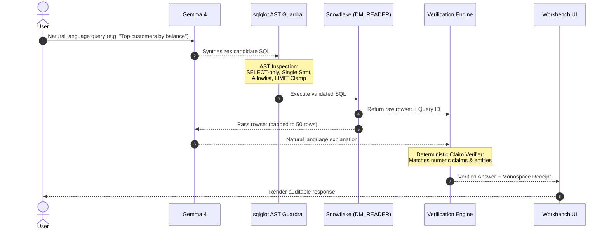

# Problem Statement: PS1 — DataMind: Talk to Your Data

> **Hacktoberfest Hack Day Dharwad × Vidkarya | ZeroDay OSS, IIIT Dharwad**  
> Team: **Code Blooded** | Person A: Aryan Verma | Person B: Kolukuri Ashrith | Person C: Kataru Deekshith Reddy  
> Repository: `https://github.com/ZERODAY-2026/Code-Blooded.git`

[](LICENSE)
[](https://www.python.org/)
[-29B5E8.svg)](https://www.snowflake.com/)
[](https://ai.google.dev/gemma)
[](src/validate.py)

---

## 📖 Table of Contents

- [1. Executive Summary](#1-executive-summary)
- [2. System Architecture & Visual Data Flow](#2-system-architecture--visual-data-flow)
  - [Turn-by-Turn Query Lifecycle](#turn-by-turn-query-lifecycle)
  - [DataMind Receipt Anatomy](#datamind-receipt-anatomy)
- [3. Core System Design: Language vs. Determinism](#3-core-system-design-language-vs-determinism)
- [4. Technical Differentiator: AST Guardrails vs. Naive Regex](#4-technical-differentiator-ast-guardrails-vs-naive-regex)
- [5. Verification: The 6 Core Rubric Archetypes](#5-verification-the-6-core-rubric-archetypes)
  - [Archetype 1: Aggregation & Analytical Metric](#archetype-1-aggregation--analytical-metric)
  - [Archetype 2: Multi-Table Relational JOIN](#archetype-2-multi-table-relational-join)
  - [Archetype 3: Follow-Up Conversational Context](#archetype-3-follow-up-conversational-context)
  - [Archetype 4: Zero-Row / Empty Result Handling](#archetype-4-zero-row--empty-result-handling)
  - [Archetype 5: Ambiguity & Out-of-Domain Requests](#archetype-5-ambiguity--out-of-domain-requests)
  - [Archetype 6: Guardrail-Blocked Mutation & Injection](#archetype-6-guardrail-blocked-mutation--injection)
- [6. Live Snowflake Execution & Verification Design](#6-live-snowflake-execution--verification-design)
- [7. Dynamic Dataset Reusability (OWID & TPC-H)](#7-dynamic-dataset-reusability-owid--tpc-h)
- [8. Team Roles & Code Ownership](#8-team-roles--code-ownership)
- [9. Project Structure](#9-project-structure)
- [10. Step-by-Step Setup & Reproduction](#10-step-by-step-setup--reproduction)
  - [Current Implementation Status](#current-implementation-status)
  - [Prerequisites](#prerequisites)
  - [Setup Walkthrough](#setup-walkthrough)
- [11. Red-Team Guardrail Matrix](#11-red-team-guardrail-matrix)
- [12. Evaluation Harness (`eval/`)](#12-evaluation-harness-eval)
- [13. Technical Boundaries & Trade-Offs](#13-technical-boundaries--trade-offs)
- [14. Troubleshooting & Operational Notes](#14-troubleshooting--operational-notes)
- [15. License](#15-license)

---

## 1. Executive Summary

**DataMind Receipts** is a verifiable, enterprise-grade natural-language interface to Snowflake cloud data warehouses.

Existing Text-to-SQL solutions frequently suffer from hallucinated data values, unconstrained SQL generation, silent schema drift, and security risks from unchecked DDL/DML execution. DataMind solves these failure modes by enforcing a strict **Language vs. Determinism Boundary**:
1. **Google Gemma 4** is utilized exclusively for language intelligence: intent parsing, candidate SQL synthesis, ambiguity identification, and explanatory prose generation.
2. **Deterministic Code** handles all critical safety invariants: AST-level SQL validation via `sqlglot`, table allowlist enforcement, automatic `LIMIT` clamping, cell-level claim verification, and machine-auditable cryptographic/AST query receipts.

---

## 2. System Architecture & Visual Data Flow

The end-to-end processing pipeline ensures that no model output reaches Snowflake without AST validation, and no generated prose reaches the user without cell-level claim matching.



### Turn-by-Turn Query Lifecycle



### DataMind Receipt Anatomy

Every query response pairs its grounded answer with an auditable, machine-verifiable receipt extracted from the parsed SQL AST and Snowflake cursor metadata:

```text
┌────────────────────────────────────────────────────────────────────────┐
│ DATAMIND QUERY RECEIPT                                                 │
├────────────────────────────────────────────────────────────────────────┤
│ Snowflake Query ID : 01b4b20a-0001-294b-0000-0001f3e6205e              │
│ Active Dataset     : TPCH (SF1)                                        │
│ Tables Referenced  : CUSTOMER, ORDERS                                  │
│ Join Equivalence   : CUSTOMER.C_CUSTKEY = ORDERS.O_CUSTKEY             │
│ Applied Filters    : ORDERS.O_ORDERDATE >= '1995-01-01'                │
│ LIMIT Enforcement  : 200 (clamped by src/validate.py)                  │
│ Rows Returned      : 10                                                │
│ Cell Verification  : PASSED (all numeric & entity claims verified)     │
└────────────────────────────────────────────────────────────────────────┘
```

---

## 3. Core System Design: Language vs. Determinism

| Responsibility Domain | Executed By | Rationale |
| :--- | :--- | :--- |
| **Natural Language Understanding** | Google Gemma 4 | Translates ambiguous user prompts into structured relational semantics. |
| **Candidate SQL Generation** | Google Gemma 4 | Translates domain requests into standard Snowflake SQL dialects. |
| **AST Security & Safety** | Python (`sqlglot`) | Rejects non-SELECT commands, comment bypasses, and unauthorized tables before execution. |
| **Execution Resource Bounds** | Python (`src/validate.py`) | Deterministically injects or clamps `LIMIT 200` to prevent unbounded query execution. |
| **Database Execution** | Snowflake (`DM_READER`) | Read-only role prevents database mutation even if an application-layer check were bypassed. |
| **Claim Verification** | Python (`src/verify.py`) | Inspects prose output against result sets; catches and replaces hallucinated numbers. |
| **Audit Receipt Construction** | Python (`src/receipt.py`) | Extracts table names, joins, filters, and Snowflake Query ID (`sfqid`) directly from the AST. |

---

## 4. Technical Differentiator: AST Guardrails vs. Naive Regex

Many Text-to-SQL systems rely on regular expressions or keyword blocklists for safety. Naive regex approaches introduce serious vulnerabilities and false rejections:

| Safety Challenge | Naive Regex Approach | DataMind AST Engine (`sqlglot`) |
| :--- | :--- | :--- |
| **Safe Column / Value Names** | Rejects harmless queries containing words like `DROP` (e.g. `WHERE status = 'DROP'`). | Parses string literals and identifiers into distinct AST nodes; recognizes literals as safe data values. |
| **Comment-Hidden Statements** | Fails or gets confused by trailing comments (`--` or `/* ... */`) wrapping secondary statements. | AST parser evaluates the entire statement tree and rejects multi-statement structures regardless of comments. |
| **Nested Subqueries & CTEs** | Regex cannot reliably distinguish between CTE table aliases and unauthorized external tables. | Recursively walks CTE definitions and verifies all referenced tables against the active dataset allowlist. |
| **LIMIT Clause Clamping** | Regex string substitution can corrupt complex queries with `UNION` or subqueries. | Modifies AST node attributes directly via `.limit(200)` and re-serializes clean, valid Snowflake SQL. |

---

## 5. Verification: The 6 Core Rubric Archetypes

The 30-question evaluation benchmark (`eval/questions.csv`) exercises six distinct query archetypes to rigorously test the system:

### Archetype 1: Aggregation & Analytical Metric
- **Target Prompt:** *"What is the total discounted revenue across all lineitems for order priority '1-URGENT'?"*
- **Candidate SQL:**
  ```sql
  SELECT SUM(l.L_EXTENDEDPRICE * (1 - l.L_DISCOUNT)) AS total_discounted_revenue
  FROM LINEITEM l
  JOIN ORDERS o ON l.L_ORDERKEY = o.O_ORDERKEY
  WHERE o.O_ORDERPRIORITY = '1-URGENT';
  ```
- **System Behavior:** Evaluates multi-column arithmetic in Snowflake; deterministic verifier checks aggregated sum against the returned cell value.

### Archetype 2: Multi-Table Relational JOIN
- **Target Prompt:** *"Show top 5 suppliers by total value shipped to customers in the 'BUILDING' segment."*
- **Candidate SQL:** Joins `SUPPLIER`, `LINEITEM`, `ORDERS`, `CUSTOMER`, and `NATION` with explicit join conditions and foreign key relations.
- **System Behavior:** Successfully walks multi-table foreign keys; receipt builder logs all 5 referenced tables and join equalities.

### Archetype 3: Follow-Up Conversational Context
- **Turn 1:** *"Which countries had the highest life expectancy in 2019?"*
- **Turn 2 (Follow-up):** *"What about India in that same year?"*
- **System Behavior:** Follow-up session handler preserves the prior turn's dataset context and temporal constraints, resolving the query without re-prompting.

### Archetype 4: Zero-Row / Empty Result Handling
- **Target Prompt:** *"What was the life expectancy in Atlantis in 2015?"*
- **System Behavior:** Executes against Snowflake, returns 0 rows. Rather than hallucinating a plausible statistic, DataMind flags an `empty` status and states clearly that no matching records exist.

### Archetype 5: Ambiguity & Out-of-Domain Requests
- **Case A (Sensible Default with Stated Assumption):** *"Who are our best customers?"* — Resolves to customers ranked by account balance (`C_ACCTBAL`), explicitly stating the assumption in the explanation block.
- **Case B (Unresolvable Ambiguity):** *"what about 2015?"* (with no conversational context) — Returns `clarify` status requesting the target indicator.
- **Case C (Out-of-Domain / Future Projection):** Asking for data beyond historical observations returns `refused` or `unsupported`.

### Archetype 6: Guardrail-Blocked Mutation & Injection
- **Target Prompt:** `"SELECT * FROM CUSTOMER; DROP TABLE ORDERS;"`
- **System Behavior:** Trapped by `src/validate.py` AST validation before reaching the database. Status set to `refused`, and the forbidden command is blocked.

---

## 6. Live Snowflake Execution & Verification Design

To ensure answers reflect live warehouse state rather than static local snapshots:
1. **Live Query Execution**: Every query is submitted to Snowflake via `snowflake-connector-python` using an active connection session under role `DM_READER`.
2. **Native Snowflake Query ID**: Every successful query returns its official Snowflake Query ID (`cursor.sfqid`), allowing operators to verify execution directly in Snowflake's History console.
3. **Execution Latency Tracking**: Records exact warehouse round-trip time in milliseconds.
4. **Independent Evaluation Connection**: The evaluation runner (`eval/run_eval.py`) connects independently to Snowflake to execute ground-truth queries, comparing API outputs without shared in-memory caches.

---

## 7. Dynamic Dataset Reusability (OWID & TPC-H)

DataMind contains zero hard-coded table schemas in Python source files. The system supports multi-dataset enterprise flexibility:

```text
config.yaml
 ├── active_dataset: owid ──> datasets/owid.yaml ──> DATAMIND.OWID.*
 └── switch-dataset: tpch ──> datasets/tpch.yaml ──> SNOWFLAKE_SAMPLE_DATA.TPCH_SF1.*
```

1. **Dataset Metadata Isolation**: Schemas, descriptions, indicator columns, and foreign keys are declared in `datasets/owid.yaml` and `datasets/tpch.yaml`.
2. **Runtime Dataset Switching**: Client applications switch active datasets via `POST /switch-dataset {"dataset": "tpch"}`. The backend resets schema context and loads the corresponding table allowlist dynamically.
3. **New Dataset Onboarding**: Supporting an additional database requires only adding a YAML schema definition and registering it in `config.yaml` — no application code changes required.

---

## 8. Team Roles & Code Ownership

| Team Member | Role | Ownership & Responsibilities |
| :--- | :--- | :--- |
| **Aryan Verma** (Team Lead) | **Person A** | Snowflake warehouse initialization (`sql/setup_snowflake.sql`), data loader scripts, SQL execution engine. |
| **Kolukuri Ashrith** | **Person B** | Backend FastAPI server (`api/`), Gemma 4 inference pipeline (`pipeline.py`), API contract definition. |
| **Kataru Deekshith Reddy** | **Person C** | Evaluation harness (`eval/questions.csv`, `eval/run_eval.py`), test suites (`tests/`), React frontend (`web/`), documentation. |

---

## 9. Project Structure

```text
Code-Blooded/
├── .agent/
│   └── AGENTS.md            # Authoritative developer rules & security constraints
├── datasets/
│   ├── owid.yaml             # Our World in Data schema & indicator declarations
│   └── tpch.yaml             # TPC-H 8-table schema declarations & foreign keys
├── eval/
│   ├── questions.csv         # 30-question ground-truth evaluation harness (draft status)
│   └── run_eval.py           # Independent HTTP-based evaluation runner
├── sql/
│   └── setup_snowflake.sql   # Snowflake RBAC setup (DM_READER, DM_LOADER, DATAMIND schema)
├── src/
│   ├── __init__.py
│   └── validate.py           # AST-based SQL guardrail engine (sqlglot)
├── tests/
│   ├── test_guardrails.py    # DDL/DML rejection & injection test suite
│   ├── test_validate.py      # sqlglot parsing & LIMIT clamping test suite
│   └── test_verify.py        # Cell verification & claim checking test suite
├── web/                      # React + Vite + Tailwind workbench frontend
├── config.yaml               # Runtime configuration (models, limits, temperatures)
├── requirements.txt          # Pinned Python dependencies
├── .env.example              # Clean environment template (no secrets committed)
├── .gitignore                # Excludes secrets, caches, and mock evaluation files
└── LICENSE                   # MIT License
```

---

## 10. Step-by-Step Setup & Reproduction

### Current Implementation Status
- **Implemented & Present in Repository**:
  - AST-based SQL safety validator (`src/validate.py`)
  - Complete automated test suites (`tests/test_guardrails.py`, `tests/test_validate.py`, `tests/test_verify.py`)
  - Ground-truth evaluation harness (`eval/questions.csv`)
  - Evaluation runner with mock isolation and DM_READER connector (`eval/run_eval.py`)
  - React workbench UI scaffold (`web/`)
- **Pending Integration (Person A & Person B)**:
  - FastAPI server endpoints (`api/`)
  - LLM pipeline integration (`pipeline.py`)
  - Secondary OWID indicator ingestion (`scripts/load_data.py`)
  - Consolidated single-entrypoint runner (`run.py`)

### Prerequisites
1. **Google AI Studio API Key**: Configured in `.env` for Gemma 4 query interpretation.
2. **Snowflake Account**: Trial or standard account with a provisioned `COMPUTE_WH` warehouse.
3. **Environment**: Python 3.11+, Node.js (for frontend build).

### Setup Walkthrough

#### 1. Clone the Repository
```bash
git clone https://github.com/ZERODAY-2026/Code-Blooded.git
cd Code-Blooded
```

#### 2. Configure Environment
Copy `.env.example` to `.env`:

**Windows PowerShell:**
```powershell
Copy-Item .env.example .env
```
**Linux / macOS / Bash:**
```bash
cp .env.example .env
```

Configure connection parameters in `.env`:
```ini
GOOGLE_API_KEY=your_gemini_api_key
SNOWFLAKE_ACCOUNT=your_account_identifier
SNOWFLAKE_USER=your_user
SNOWFLAKE_PASSWORD=your_password
SNOWFLAKE_WAREHOUSE=COMPUTE_WH
SNOWFLAKE_DATABASE=DATAMIND
SNOWFLAKE_SCHEMA=OWID
SNOWFLAKE_ROLE=DM_READER
```

#### 3. Install Python Dependencies
```bash
pip install -r requirements.txt
```

#### 4. Initialize Snowflake RBAC (Person A)
Run `sql/setup_snowflake.sql` in a Snowflake Worksheet as `ACCOUNTADMIN` to create the `DATAMIND` database, `OWID` schema, and `COMPUTE_WH` warehouse grants.

#### 5. Run the Test Suites
Execute the test suites with `pytest`:
```bash
python -m pytest tests/ -v
```

#### 6. Run the Frontend Workbench
```bash
cd web
npm install
npm run dev
```
Open `http://localhost:3000` (port configured in `web/vite.config.js`) in your browser.  
*(Note: `python run.py` single-command entrypoint is scheduled once FastAPI serves prebuilt `web/dist`).*

---

## 11. Red-Team Guardrail Matrix

All SQL generated by the language model is validated by `src/validate.py` before execution. The AST engine enforces the following checks:

| Policy Case | Attempted SQL Syntax | Guardrail Action | Corresponding Test Function |
| :--- | :--- | :---: | :--- |
| **DROP TABLE** | `DROP TABLE CUSTOMER;` | ❌ BLOCKED | `test_drop_table_rejected` |
| **DELETE** | `DELETE FROM CUSTOMER WHERE C_CUSTKEY = 1;` | ❌ BLOCKED | `test_delete_rejected` |
| **INSERT** | `INSERT INTO CUSTOMER (C_NAME) VALUES ('x');` | ❌ BLOCKED | `test_insert_rejected` |
| **UPDATE** | `UPDATE CUSTOMER SET C_ACCTBAL = 0;` | ❌ BLOCKED | `test_update_rejected` |
| **TRUNCATE** | `TRUNCATE TABLE CUSTOMER;` | ❌ BLOCKED | `test_truncate_rejected` |
| **ALTER TABLE** | `ALTER TABLE CUSTOMER ADD COLUMN x VARCHAR;` | ❌ BLOCKED | `test_alter_table_rejected` |
| **MERGE** | `MERGE INTO CUSTOMER USING ...;` | ❌ BLOCKED | `test_merge_rejected` |
| **COPY INTO** | `COPY INTO CUSTOMER FROM @my_stage;` | ❌ BLOCKED | `test_copy_into_rejected` |
| **CALL Procedure** | `CALL my_stored_procedure();` | ❌ BLOCKED | `test_call_rejected` |
| **GRANT / REVOKE** | `GRANT ALL PRIVILEGES ON TABLE CUSTOMER...;` | ❌ BLOCKED | `test_grant_rejected`, `test_revoke_rejected` |
| **CREATE TABLE** | `CREATE TABLE evil_copy AS SELECT ...;` | ❌ BLOCKED | `test_create_table_rejected` |
| **Multi-Statement**| `SELECT * FROM CUSTOMER; DROP TABLE ORDERS;` | ❌ BLOCKED | `test_select_then_drop_rejected` |
| **Comment-Hidden Statement** | `SELECT * FROM CUSTOMER; --\nDROP TABLE ORDERS;` | ❌ BLOCKED | `test_comment_hidden_second_statement_rejected` |
| **Prompt Injection (Bypass)** | `SELECT * FROM CUSTOMER /* bypass */; DROP TABLE CUSTOMER;` | ❌ BLOCKED | `test_prompt_injection_comment_bypass_rejected` |
| **Prompt Injection (Exfil)** | `SELECT C_NAME FROM CUSTOMER UNION SELECT PASSWORD FROM ADMIN_USERS;` | ❌ BLOCKED | `test_prompt_injection_union_exfiltration_rejected` |
| **Unlisted Table** | `SELECT * FROM INFORMATION_SCHEMA.TABLES;` | ❌ BLOCKED | `test_unlisted_table_rejected` |
| **Missing LIMIT** | `SELECT * FROM ORDERS;` | ⚠️ CLAMPED | Enforces `LIMIT 200` |
| **Excessive LIMIT**| `SELECT * FROM ORDERS LIMIT 50000;` | ⚠️ CLAMPED | Clamped to `LIMIT 200` |
| **Valid SELECT** | `SELECT C_NAME, C_ACCTBAL FROM CUSTOMER LIMIT 10;` | ✅ PASSED | `test_simple_select_passes` |

---

## 12. Evaluation Harness (`eval/`)

The evaluation harness consists of two standalone components:

1. **`eval/questions.csv`**: A 30-question ground-truth evaluation benchmark covering:
   - `single_table` (8 questions)
   - `join` (8 questions, including multi-table joins)
   - `cte_multistep` (5 questions)
   - `ambiguous` (3 questions: 2 answered with stated assumptions, 1 true `clarify`)
   - `empty_or_unsupported` (3 questions: testing `empty` rowsets and out-of-domain `refused`)
   - `followup` (3 multi-turn contextual questions)
   - **Held-out subset**: 10 questions tagged held-out for evaluation.

2. **`eval/run_eval.py`**: Independent evaluation runner that queries the API over HTTP, maintains its own separate Snowflake connection as `DM_READER`, and compares result sets using column-name matching, date/number normalisation, and tolerance thresholds.

### Running Evaluation
```bash
# Offline simulation mode (writes strictly to git-ignored eval/results.mock.json)
python eval/run_eval.py --mock

# Live evaluation mode (against running FastAPI service)
python eval/run_eval.py --api-url http://localhost:8000
```

> **Evaluation Notice**: Results are produced by `eval/run_eval.py`. All 30 ground-truth questions currently hold `status=draft`. Rows count toward headline accuracy only once their ground-truth data snapshots have been verified against live data by the team.

---

## 13. Technical Boundaries & Trade-Offs

1. **SELECT-Only Enforcement**: To guarantee complete protection against accidental data corruption or malicious mutations, only read-only `SELECT` statements are permitted. Mutations cannot be initiated via natural language.
2. **Mandatory LIMIT Clamping (Max 200 Rows)**: Unbounded queries (`SELECT * FROM LINEITEM`) can rapidly exhaust warehouse compute credits and browser memory. Every query is clamped to a maximum of 200 rows by the AST engine.
3. **Prose Row Capping (50 Rows)**: When passing query results to Gemma 4 for natural-language synthesis, only the top 50 rows are provided to prevent context bloat while preserving analytical fidelity.
4. **Conversational History Window**: Multi-turn sessions retain the most recent question-SQL pairs to resolve conversational follow-ups without exceeding model context limits.

---

## 14. Troubleshooting & Operational Notes

- **Snowflake MFA / Key-Pair Authentication**: If your Snowflake user enforces Duo MFA or SSO, password authentication will time out. Configure key-pair authentication or set `authenticator='externalbrowser'` in your local configuration.
- **Model Configuration**: Model names and parameters are read directly from `config.yaml`. To switch models or providers, update `config.yaml` rather than editing source code.
- **`[TODO]` Technical Specifications**:
  - *LLM Tier*: `[TODO: Gemma model runtime specifications, exact parameter tier, and benchmark latency to be confirmed post-pipeline integration]`
  - *Data Attribution*: `[TODO: Add exact Our World in Data download timestamp, commit SHA, and upstream indicator URL]`

---

## 15. License

This project is licensed under the **MIT License** — see the [LICENSE](LICENSE) file for details.
