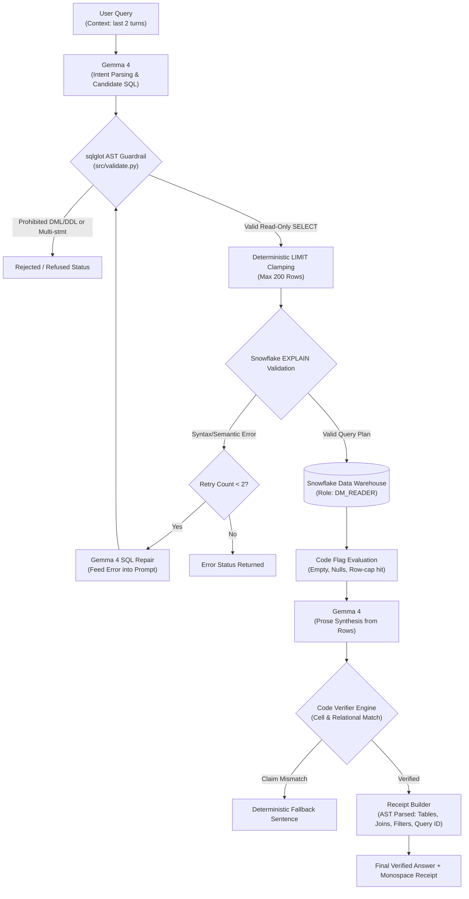
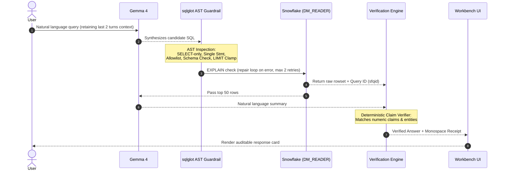

# DataMind Receipts — System Architecture Specification

> **Hacktoberfest Hack Day Dharwad × Vidkarya | ZeroDay OSS, IIIT Dharwad**  
> Team: **Code Blooded** | Problem Statement: **PS1 — DataMind: Talk to Your Data**

---

## 1. Architectural Philosophy: The Language vs. Determinism Boundary

DataMind Receipts enforces an uncompromising separation between statistical language modeling and deterministic system execution:

```text
┌────────────────────────────────────────────────────────────────────────┐
│ GOOGLE GEMMA 4 (Language Domain)                                       │
│  - Natural Language Intent Understanding                               │
│  - Schema-grounded Candidate SQL Synthesis                             │
│  - Ambiguity Identification & Follow-up Interpretation                 │
│  - Grounded Prose Synthesis from Returned Rows                         │
└──────────────────────────────────┬─────────────────────────────────────┘
                                   │
                                   ▼
┌────────────────────────────────────────────────────────────────────────┐
│ DETERMINISTIC PYTHON ENGINE (Safety, Verification & Bounds)            │
│  - AST Parsing & DDL/DML Rejection via sqlglot                         │
│  - Table Allowlist & Schema Isolation Enforcement                      │
│  - Deterministic LIMIT 200 Clamping                                    │
│  - Snowflake EXPLAIN Plan Validation & Repair Loop (max 2 retries)     │
│  - Cell-Level Claim Matching against Returned Rowset (src/verify.py (planned)) │
│  - Monospace Query Receipt Construction (src/receipt.py (planned))             │
└──────────────────────────────────┬─────────────────────────────────────┘
                                   │
                                   ▼
┌────────────────────────────────────────────────────────────────────────┐
│ SNOWFLAKE CLOUD DATA WAREHOUSE (Execution Platform)                    │
│  - Role: DM_READER (Strict SELECT-only privilege isolation)            │
│  - Warehouse: DM_WH (X-Small, 60s auto-suspend, 30s statement timeout) │
│  - Native Query ID Tracking (cursor.sfqid)                             │
└────────────────────────────────────────────────────────────────────────┘
```

---

## 2. End-to-End Query Lifecycle



### Turn-by-Turn Interaction



---

## 3. Database Role-Based Access Control (RBAC)

1. **`DM_READER` Role (Application Service)**:
   - Configured in application `.env`.
   - Granted `USAGE` on warehouse `DM_WH`, database `DATAMIND`, and schema `DATAMIND.OWID`.
   - Granted `SELECT` on tables in `DATAMIND.OWID` and `SNOWFLAKE_SAMPLE_DATA.TPCH_SF1`.
   - Explicitly lacks `INSERT`, `UPDATE`, `DELETE`, `DROP`, `ALTER`, or `CREATE` permissions.
2. **`DM_LOADER` Role (Operator Administration)**:
   - Used solely by Person A for executing data ingestion or running live data mutation demonstrations.
   - Credentials for `DM_LOADER` are strictly excluded from web application configurations.
3. **`DM_WH` Compute Warehouse**:
   - Size: `XSMALL` to minimize cloud credit consumption.
   - `AUTO_SUSPEND = 60`: Automatically suspends compute resources after 60 seconds of inactivity.
   - `STATEMENT_TIMEOUT_IN_SECONDS = 30`: Automatically aborts runaway queries.

---

## 4. AST Guardrail Engine (`src/validate.py`)

The safety engine inspects SQL abstract syntax trees using `sqlglot` prior to database execution:
- **Statement Isolation**: Rejects queries parsing into more than one statement (blocking semicolon chaining and comment-hidden statements).
- **Type Filtering**: Rejects any non-SELECT AST node type (blocking `DROP`, `DELETE`, `INSERT`, `UPDATE`, `ALTER`, `TRUNCATE`, `MERGE`, `COPY`, `CALL`, `GRANT`, `REVOKE`, `CREATE`).
- **Table Allowlist**: Inspects all `exp.Table` references (including inside CTEs and subqueries) against the active dataset table allowlist.
- **Schema Qualification Isolation**: Rejects queries referencing allowlisted table names located in unlisted or foreign schemas (e.g. `OTHER_SCHEMA.CUSTOMER`).
- **Automatic LIMIT Injection & Clamping**: Deterministically injects `LIMIT 200` if absent, or clamps excessive limits (`LIMIT 50000` -> `LIMIT 200`).

---

## 5. Verification & Receipt Engine (Planned Contract)

1. **Cell-Level Claim Verification (`src/verify.py` (planned))**:
   - Parses numbers, percentages, and entity names from Gemma's prose explanation.
   - Compares every extracted token against the literal rowset values returned by Snowflake.
   - If a claim cannot be verified against result cells, replaces the prose with a deterministic fallback template:
     `"Query executed successfully returning N rows. [Values]: {col1}, {col2}."`
2. **Monospace Receipt Construction (`src/receipt.py` (planned))**:
   - Walks the validated AST to extract tables touched, join conditions, and filter predicates.
   - Reads `cursor.sfqid` from the Snowflake cursor.
   - Produces an auditable monospace card embedded in API responses.

---

## 6. Runtime Configuration & Multi-Dataset Support

Configuration is governed by `config.yaml`:
- **`active_dataset`**: Sets default active dataset (`owid` or `tpch`).
- **`datasets`**: Maps datasets to schema definitions (`datasets/owid.yaml` and `datasets/tpch.yaml`).
- **`POST /switch-dataset`**: Client endpoint allowing dataset switching at runtime.
